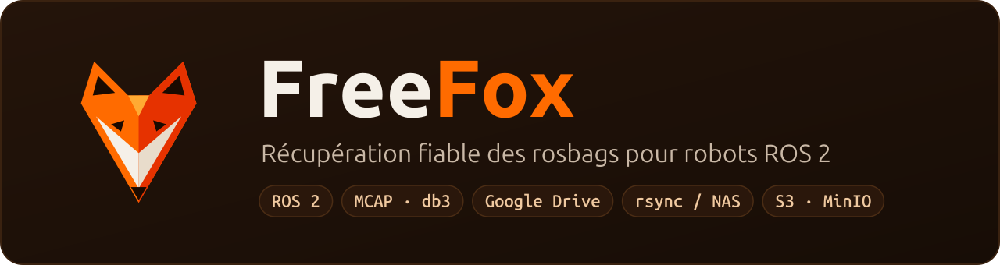
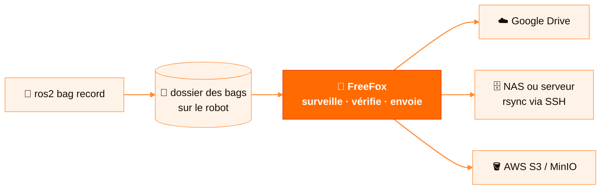
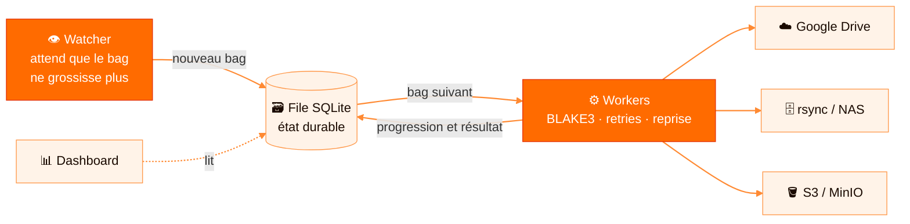

<p align="center">
  <a href="https://github.com/thoukam/freefox">
    
  </a>
</p>

<p align="center">
  <a href="https://github.com/thoukam/freefox/actions/workflows/ci.yml"></a>
  <a href="https://pypi.org/project/freefox/"></a>
  <a href="https://thoukam.github.io/freefox/"></a>
  <a href="https://github.com/thoukam/freefox/pkgs/container/freefox"></a>
  <a href="LICENSE"></a>
  <a href="CONTRIBUTING.fr.md"></a>
</p>

**FreeFox récupère chaque rosbag ROS 2 de vos robots, de manière fiable.** C'est un petit service
Linux qui surveille votre dossier d'enregistrement et envoie les rosbags terminés vers Google Drive,
un NAS via rsync/SSH ou tout bucket compatible S3. Les uploads reprennent après un crash, chaque
fichier est vérifié avec BLAKE3, et un dashboard en direct montre ce qui se passe.

> **Statut : 0.2, bêta.** Le cœur (file, reprise, intégrité, trois backends) est implémenté et
> testé ; le format de configuration peut encore évoluer avant la 1.0.
> [Notes de version](CHANGELOG.fr.md) · [Feuille de route](#feuille-de-route) · [English](README.md)

## Pourquoi FreeFox ?

Un robot de terrain produit des gigaoctets de rosbags à chaque mission, souvent sur un Wi-Fi ou une
4G instable. Copiés à la main, des bags se perdent, se dupliquent ou se corrompent, et on ne s'en
rend compte qu'au moment d'exploiter les données.



FreeFox tourne sur le robot et s'en occupe :

- **Uniquement des bags complets.** Il attend la fin d'un enregistrement avant d'y toucher.
- **Rien ne se perd.** Chaque transfert est gardé dans une file SQLite locale, malgré les crashs et redémarrages.
- **Reprendre, pas recommencer.** Un upload de 20 Go interrompu repart là où il s'est arrêté.
- **Preuve d'intégrité.** Une empreinte BLAKE3 prouve que le fichier est arrivé intact, et un même contenu n'est jamais envoyé deux fois.
- **Votre stockage, sans abonnement.** Libre, auto-hébergé, sans dépendance à un fournisseur.

<p align="center">
  
</p>

## Fonctionnalités

- **Collecte automatique** : service systemd ou conteneur Docker, démarrage au boot, surveillance récursive.
- **Uniquement des bags complets** : un fichier n'entre en file qu'après `stable_seconds` sans changement de taille.
- **File persistante** : chaque transfert est stocké en SQLite (`queued → uploading → done / failed / conflict`).
- **Reprise des uploads** : sessions resumables Google Drive et état multipart S3 persistés, `--partial` pour rsync.
- **Retries intelligents** : backoff exponentiel, délais dédiés aux erreurs de quota et réseau, remise en file au démarrage.
- **Intégrité BLAKE3** : empreinte calculée localement, stockée côté distant (appProperties Drive, métadonnées S3, sidecar rsync).
- **Doublons et conflits** : un contenu identique n'est jamais renvoyé ; un fichier *différent* au même chemin passe en conflit sans être écrasé.
- **Arborescence propre** : `<préfixe>/<robot_id>/<AAAA-MM-JJ>/<fichier>`, prête pour une flotte.
- **Trois backends** : Google Drive (OAuth2 ou compte de service / Shared Drive), rsync (disque, NAS, SSH), AWS S3 et MinIO.
- **Dashboard local** : progression, débit MiB/s et Mbps, ETA, retries, erreurs et fichiers surveillés.
- **Sécurisé par défaut** : secrets S3 refusés dans le YAML, secrets masqués dans les logs, unité systemd durcie.
- **Image multi-architecture** : `ghcr.io/thoukam/freefox` pour `linux/amd64` et `linux/arm64`.

Compatible avec les deux formats de bags ROS 2 : **`.mcap`** et **`.db3`**.

## Démarrage rapide

### pip

```bash
pip install "freefox[s3]"        # retirez [s3] si vous n'utilisez pas S3 / MinIO
freefox --config config.yaml     # le service d'upload
freefox-dashboard --config config.yaml --host 0.0.0.0   # dashboard sur :8765
freefox-status /var/lib/freefox/queue.db                # état de la file dans le terminal
```

Partez de [`config/config.example.yaml`](config/config.example.yaml).

### Docker

```bash
git clone https://github.com/thoukam/freefox && cd freefox
cp config/config.docker.example.yaml config/config.docker.yaml
cp .env.example .env
docker compose pull && docker compose up -d
```

Dashboard : `http://IP_DU_ROBOT:8765`. Guide complet : [docs/docker-deployment.md](docs/fr/docker-deployment.md).

### systemd

```bash
git clone https://github.com/thoukam/freefox && cd freefox
sudo ./install.sh
sudo nano /etc/freefox/config.yaml
sudo systemctl enable --now freefox
journalctl -u freefox -f
```

### Essai local sans compte cloud

```bash
python3 -m venv .venv
.venv/bin/pip install -e ".[dev]"
.venv/bin/python scripts/local_smoke.py
```

### Dashboard

```bash
.venv/bin/freefox-dashboard --config config/local.gdrive.yaml --host 127.0.0.1 --port 8765
```

Utilisez `--host 0.0.0.0` pour y accéder depuis un autre PC du réseau. Le dashboard n'a pas encore
d'authentification : ne l'exposez que sur un réseau de confiance.

## Configuration

Toutes les options sont commentées dans [`config/config.example.yaml`](config/config.example.yaml).

| Clé | Exemple | Rôle |
|---|---|---|
| `robot_id` | `robot-01` | Nom du robot dans le chemin distant (défaut : hostname) |
| `watch.directory` | `/home/ros/bags` | Dossier surveillé (récursif) |
| `watch.stable_seconds` | `5.0` | Temps sans modification avant upload |
| `upload.workers` | `2` | Uploads en parallèle |
| `upload.chunk_size` | `8388608` | Taille des chunks / parts |
| `upload.verify_blake3` | `true` | Calcule et stocke l'empreinte BLAKE3 |
| `upload.deduplicate_by_hash` | `true` | Évite de renvoyer un contenu déjà présent |
| `upload.delete_after_upload` | `false` | Supprime le bag local après upload confirmé |
| `storage.backend` | `gdrive` | `gdrive`, `rsync` ou `s3` |
| `drive.target_folder_id` | `...` | Dossier Google Drive cible |
| `rsync.destination` | `user@host:/data/freefox` | Destination rsync locale ou SSH |
| `s3.bucket` / `s3.endpoint_url` | `robot-bags` | Bucket S3 et endpoint MinIO éventuel |
| `queue_db` | `/var/lib/freefox/queue.db` | Base SQLite persistante |

Variables d'environnement : `FREEFOX_ROBOT_ID`, `FREEFOX_CREDENTIALS`, `FREEFOX_TOKEN_PATH`, et la
chaîne standard `AWS_*` pour S3.

## Fonctionnement



1. Le **watcher** repère les nouveaux fichiers `.mcap` / `.db3` et attend qu'ils ne grossissent plus.
2. La **file** enregistre le transfert avec un instantané de sa destination : modifier la config
   ensuite ne détourne jamais un transfert déjà en cours.
3. Les **workers** calculent le BLAKE3, inspectent le côté distant (absent, identique ou en conflit),
   envoient avec reprise et classent les erreurs (temporaire, quota, authentification, config, conflit).
4. Les **backends** implémentent une petite interface commune : en ajouter un nouveau est simple.

Plus de détails : [docs/fr/architecture.md](docs/fr/architecture.md).

## Documentation

- [Installation](docs/fr/installation.md)
- [Google Drive](docs/fr/google-drive-setup.md)
- [S3 / MinIO](docs/fr/s3-storage.md)
- [Docker et rsync](docs/fr/docker-deployment.md)
- [Architecture](docs/fr/architecture.md)
- [Site du projet](https://thoukam.github.io/freefox/)

Tous les guides existent en français ([`docs/fr/`](docs/fr/)) et en anglais ([`docs/en/`](docs/en/)).

## Outils

```bash
.venv/bin/freefox-status /var/lib/freefox/queue.db   # état de la file
.venv/bin/python scripts/gdrive_smoke.py --config config/local.gdrive.yaml
.venv/bin/python scripts/s3_smoke.py --config config/local.s3.yaml --file /tmp/test.mcap
.venv/bin/python -m pytest
```

## Feuille de route

| Phase | Objectif | Statut |
|---|---|---|
| **v0.1** | Watcher, file SQLite durable, Google Drive (resumable), rsync / NAS, intégrité BLAKE3 et déduplication, dashboard, image Docker multi-arch | ✅ Livré |
| **v0.2** | Backend AWS S3 / MinIO avec multipart durable, détection de conflits, snapshot de destination par transfert | ✅ Livré |
| **v0.3** | Observabilité et sécurité : Prometheus `/metrics`, authentification du dashboard, logs structurés | 🚧 Prochaine étape |
| **v0.4** | Uploads intelligents : règles par topic ROS 2 ou métadonnées du bag, limite de bande passante, fenêtres horaires (Wi-Fi uniquement, la nuit…) | 📋 Planifié |
| **v0.5** | Nouveaux backends : Azure Blob, Google Cloud Storage, WebDAV | 📋 Planifié |
| **v1.0** | Échelle flotte : vue centralisée multi-robots, paquet `ros2` natif, format de config stable | 🔭 Vision |

Le détail de ce qui est livré est dans le [CHANGELOG](CHANGELOG.fr.md). Un besoin dans votre labo ou
votre entreprise ? [Ouvrez une issue](https://github.com/thoukam/freefox/issues) : les cas d'usage
réels guident les priorités.

## Contribuer

Toutes les contributions sont bienvenues : bugs, documentation, traductions, nouveaux backends,
dashboard, retours d'expérience sur de vrais robots. Commencez par le [guide de contribution](CONTRIBUTING.fr.md), et respectez le
[code de conduite](CODE_OF_CONDUCT.fr.md). Les failles de sécurité se signalent en privé :
voir [SECURITY.fr.md](SECURITY.fr.md).

## Licence

[Apache 2.0](LICENSE). Libre pour un usage académique et commercial.

Créé et maintenu par **Yves Thoukam** ([thoukamy@gmail.com](mailto:thoukamy@gmail.com)).
