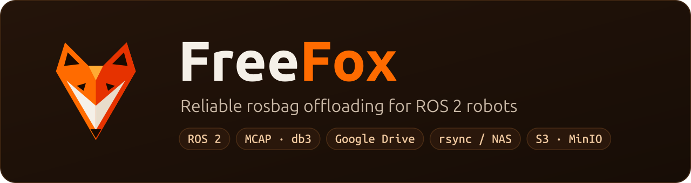
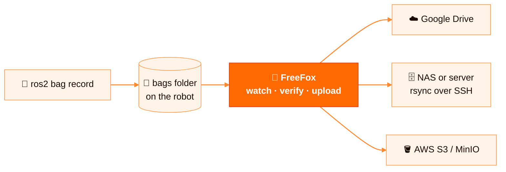
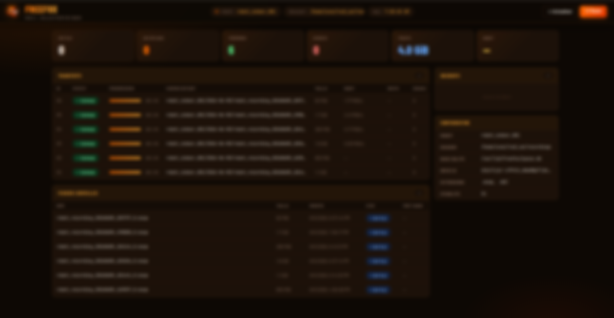
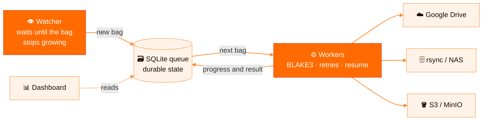

<p align="center">
  <a href="https://github.com/thoukam/freefox">
    
  </a>
</p>

<p align="center">
  <a href="https://github.com/thoukam/freefox/actions/workflows/ci.yml"></a>
  <a href="https://pypi.org/project/freefox/"></a>
  <a href="https://thoukam.github.io/freefox/"></a>
  <a href="https://github.com/thoukam/freefox/pkgs/container/freefox"></a>
  <a href="https://github.com/thoukam/freefox/blob/main/LICENSE"></a>
  <a href="https://github.com/thoukam/freefox/blob/main/CONTRIBUTING.md"></a>
</p>

**FreeFox gets every ROS 2 bag off your robots, reliably.** It is a small Linux service that
watches your recording folder and ships finished rosbags to Google Drive, a NAS over rsync/SSH or
any S3-compatible bucket. Uploads resume after a crash, every file is verified with BLAKE3, and a
live dashboard shows what is happening.

> **Status: 0.2, beta.** The core (queue, resume, integrity, three backends) is implemented and
> tested; the configuration format may still change before 1.0.
> [Release notes](https://github.com/thoukam/freefox/blob/main/CHANGELOG.md) · [Roadmap](#roadmap) · [Français](https://github.com/thoukam/freefox/blob/main/README.fr.md)

## Why FreeFox?

Field robots generate gigabytes of rosbags per run, often on flaky Wi-Fi or 4G. Copying them
by hand gets bags lost, duplicated or corrupted, and nobody notices until the data is needed.



FreeFox runs on the robot and takes care of that job:

- **Complete bags only.** It waits until a recording is finished before touching it.
- **Nothing gets lost.** Every transfer is remembered in a local SQLite queue, across crashes and reboots.
- **Resume, don't restart.** An interrupted 20 GB upload continues where it stopped.
- **Proof of integrity.** A BLAKE3 fingerprint shows the file arrived intact, and identical content is never sent twice.
- **Your storage, no subscription.** Free, self-hosted, no vendor lock-in.

<p align="center">
  <br>
  <em>The local dashboard: progress, throughput, ETA, retries and integrity status per bag.</em>
</p>

## Features

| | |
|---|---|
| **Hands-off collection** | Runs as a systemd service or a Docker container, starts at boot, watches folders recursively. |
| **Complete bags only** | A file is queued only once its size has been stable for `stable_seconds`; `*.active`, `*.tmp` and `metadata.yaml` are ignored. |
| **Durable queue** | Every transfer lives in SQLite (`queued → uploading → done / failed / conflict`) and survives crashes and reboots. |
| **Resumable uploads** | Google Drive resumable sessions and S3 multipart state are persisted; rsync uses `--partial`. |
| **Smart retries** | Exponential backoff, dedicated delays for quota and network errors, failed items requeued on start. |
| **BLAKE3 integrity** | Fingerprint computed locally, stored remotely (Drive `appProperties`, S3 metadata, rsync sidecar) and checked. |
| **Deduplication and conflict safety** | Identical content is never re-uploaded. A *different* file at the same path is flagged as a conflict and never overwritten. |
| **Tidy layout** | Files land under `<prefix>/<robot_id>/<YYYY-MM-DD>/<filename>`, ready for a whole fleet. |
| **Three backends** | Google Drive (OAuth2 or service account / Shared Drive), rsync (local disk, NAS, SSH), AWS S3 and MinIO-compatible. |
| **Live dashboard** | Built-in web UI: per-bag progress, MiB/s and Mbps throughput, ETA, retries, errors and watched files. |
| **Secure by default** | S3 secrets are rejected in YAML (standard AWS credential chain only), and secrets are redacted from logs. The systemd unit is hardened. |
| **Multi-arch image** | `ghcr.io/thoukam/freefox` for `linux/amd64` and `linux/arm64` (Jetson, Raspberry Pi, industrial PCs). |

Works with both ROS 2 bag formats: **`.mcap`** and **`.db3`**.

## Quick start

### pip

```bash
pip install "freefox[s3]"        # drop [s3] if you do not need S3 / MinIO
freefox --config config.yaml     # the upload service
freefox-dashboard --config config.yaml --host 0.0.0.0   # dashboard on :8765
freefox-status /var/lib/freefox/queue.db                # queue status in the terminal
```

Start from [`config/config.example.yaml`](https://github.com/thoukam/freefox/blob/main/config/config.example.yaml).

### Docker

```bash
git clone https://github.com/thoukam/freefox && cd freefox
cp config/config.docker.example.yaml config/config.docker.yaml   # choose your backend
cp .env.example .env                                              # set the bags folder on the host
docker compose pull && docker compose up -d
```

Open the dashboard at `http://<robot-ip>:8765`. Full guide: [docs/docker-deployment.md](https://github.com/thoukam/freefox/blob/main/docs/en/docker-deployment.md).

### systemd (bare metal)

```bash
git clone https://github.com/thoukam/freefox && cd freefox
sudo ./install.sh                       # installs the package, /etc/freefox and the unit
sudo nano /etc/freefox/config.yaml      # set watch.directory and your backend
sudo systemctl enable --now freefox
journalctl -u freefox -f
```

### Try it locally in 2 minutes (no cloud account)

```bash
python3 -m venv .venv
.venv/bin/pip install -e ".[dev]"
.venv/bin/python scripts/local_smoke.py
```

## Minimal configuration

```yaml
robot_id: robot-01            # or FREEFOX_ROBOT_ID, defaults to the hostname

watch:
  directory: /home/ros/bags
  stable_seconds: 5.0

storage:
  backend: rsync              # gdrive | rsync | s3

rsync:
  destination: user@nas:/data/freefox
```

Every option is documented in [`config/config.example.yaml`](https://github.com/thoukam/freefox/blob/main/config/config.example.yaml).
Backend guides:

- **Google Drive**: [docs/google-drive-setup.md](https://github.com/thoukam/freefox/blob/main/docs/en/google-drive-setup.md) (OAuth2 for personal drives, service account and Shared Drive for fleets)
- **AWS S3 / MinIO**: [docs/s3-storage.md](https://github.com/thoukam/freefox/blob/main/docs/en/s3-storage.md) (`pip install -e ".[s3]"`)
- **rsync / NAS / SSH**: [docs/docker-deployment.md](https://github.com/thoukam/freefox/blob/main/docs/en/docker-deployment.md#rsync-on-a-real-robot)

## How it works



1. **Watcher** detects new `.mcap` / `.db3` files and waits until they stop growing.
2. **Queue** records the transfer together with a snapshot of its destination. Changing the
   config later never redirects a transfer that is already in progress.
3. **Workers** compute BLAKE3, check the remote side (missing, identical or conflict), upload with
   resume, and classify errors (transient, quota, auth, config, conflict).
4. **Backends** implement one small, provider-neutral interface, so adding a new one is easy.

More detail: [docs/architecture.md](https://github.com/thoukam/freefox/blob/main/docs/en/architecture.md).

## Documentation

| Guide | |
|---|---|
| [Installation](https://github.com/thoukam/freefox/blob/main/docs/en/installation.md) | Local dev setup, systemd, real-bag testing, resume behaviour |
| [Google Drive](https://github.com/thoukam/freefox/blob/main/docs/en/google-drive-setup.md) | OAuth2 vs service account, Shared Drives |
| [S3 / MinIO](https://github.com/thoukam/freefox/blob/main/docs/en/s3-storage.md) | Credentials chain, private CA, multipart resume |
| [Docker](https://github.com/thoukam/freefox/blob/main/docs/en/docker-deployment.md) | Compose, GHCR image, rsync over SSH from a robot |
| [Architecture](https://github.com/thoukam/freefox/blob/main/docs/en/architecture.md) | Components, queue states, backend contract |
| [Website](https://thoukam.github.io/freefox/) | Project site |

Every guide is available in English ([`docs/en/`](https://github.com/thoukam/freefox/tree/main/docs/en/)) and French ([`docs/fr/`](https://github.com/thoukam/freefox/tree/main/docs/fr/)).

## Roadmap

| Phase | Focus | Status |
|---|---|---|
| **v0.1** | Watcher, durable SQLite queue, Google Drive (resumable), rsync / NAS, BLAKE3 integrity and deduplication, dashboard, multi-arch Docker image | ✅ Shipped |
| **v0.2** | AWS S3 / MinIO backend with durable multipart, conflict detection, per-transfer destination snapshots | ✅ Shipped |
| **v0.3** | Observability and security: Prometheus `/metrics`, dashboard authentication, structured logs | 🚧 Next |
| **v0.4** | Smarter uploads: rules by ROS 2 topic or bag metadata, bandwidth limits, upload time windows (Wi-Fi only, at night…) | 📋 Planned |
| **v0.5** | More backends: Azure Blob, Google Cloud Storage, WebDAV | 📋 Planned |
| **v1.0** | Fleet scale: central multi-robot view, native `ros2` package, stable config format | 🔭 Vision |

Shipped changes are detailed in the [CHANGELOG](https://github.com/thoukam/freefox/blob/main/CHANGELOG.md). Have a need from your lab or company?
[Open an issue](https://github.com/thoukam/freefox/issues). Real use cases shape the priorities.

## Contributing

FreeFox is young, and contributions of every size are welcome: bug reports, docs,
translations, new backends, dashboard work, field reports from real robots.

```bash
git clone https://github.com/thoukam/freefox && cd freefox
python3 -m venv .venv && .venv/bin/pip install -e ".[dev,s3]"
.venv/bin/python -m pytest
```

Read [CONTRIBUTING.md](https://github.com/thoukam/freefox/blob/main/CONTRIBUTING.md) to get started, and look for issues labelled
[`good first issue`](https://github.com/thoukam/freefox/labels/good%20first%20issue).
Please follow our [Code of Conduct](https://github.com/thoukam/freefox/blob/main/CODE_OF_CONDUCT.md) and report vulnerabilities privately as
described in [SECURITY.md](https://github.com/thoukam/freefox/blob/main/SECURITY.md).

Using FreeFox on a robot? Tell us in an issue. Real-world feedback shapes the roadmap.

## License

[Apache 2.0](https://github.com/thoukam/freefox/blob/main/LICENSE). Free for academic and commercial use.

Created and maintained by **Yves Thoukam** ([thoukamy@gmail.com](mailto:thoukamy@gmail.com)).
