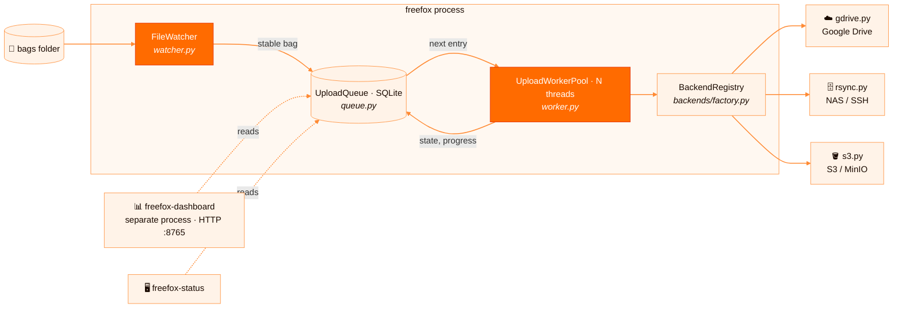
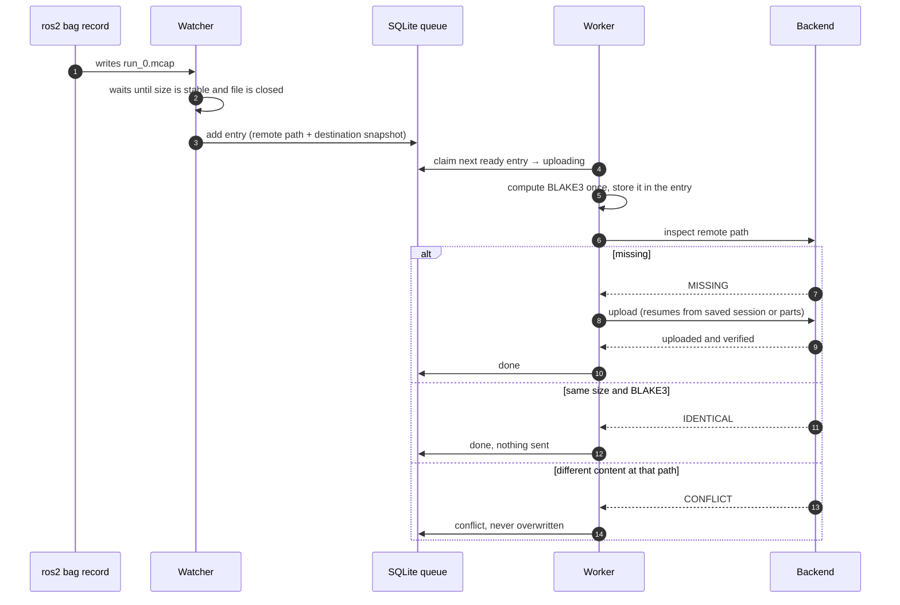
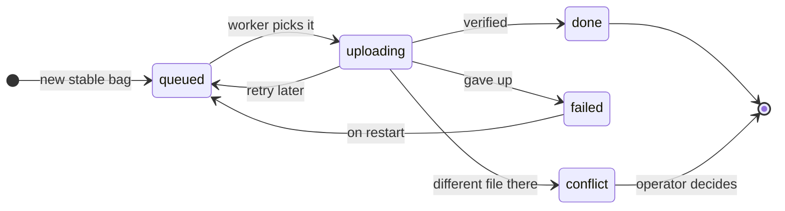
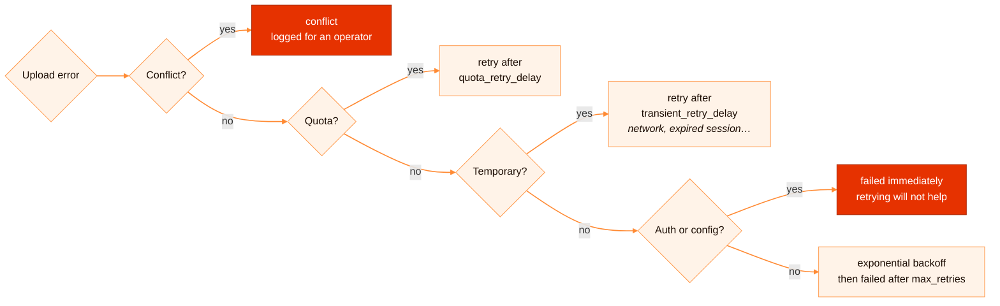

**English** · [Français](../fr/architecture.md)

# Architecture

This page explains how FreeFox is put together. Read it before you change the queue, a worker or a
backend.

## Overview



`freefox/service.py` wires everything together. It is also the `freefox` CLI entry point.

## Components

| Module | Responsibility |
|---|---|
| `config.py` | Loads YAML into typed dataclasses, applies `FREEFOX_*` env overrides and validates backend settings. It rejects S3 secrets in YAML. |
| `watcher.py` | Watches `watch.directory` recursively (watchdog/inotify, with a polling fallback). It filters by extension and ignore globs, and only reports a file once its size has been stable for `stable_seconds` and no process holds it open (`/proc/*/fd`). |
| `queue.py` | Durable SQLite queue (WAL). It owns transfer state, retry scheduling, Drive resumable session URIs and S3 multipart state. It migrates old databases in place. |
| `worker.py` | Thread pool. It computes BLAKE3, asks the backend to deduplicate or upload, records progress and maps errors to a queue outcome. |
| `integrity.py` | Streaming BLAKE3. |
| `backends/__init__.py` | Provider-neutral contract: `StorageBackend` protocol, `Inspection` enum and the error hierarchy. |
| `backends/factory.py` | `BackendRegistry`: lazily builds and caches one backend per destination snapshot. |
| `dashboard.py` | `freefox-dashboard` command. Standalone HTTP server, standard library only. It reads the same SQLite file and serves `/` and `/api/status`. |
| `status.py` | `freefox-status` command: prints the queue as a table in the terminal. |

## Lifecycle of a bag



1. `ros2 bag record` writes `run_0.mcap` into the watched folder.
2. The watcher sees it and waits until it is stable and closed, then calls `CollectorService._on_new_bag`.
3. The service builds the remote path `<prefix>/<robot_id>/<YYYY-MM-DD>/<filename>` and adds a queue
   row holding the **backend name and a snapshot of its destination settings**. Queued work keeps its
   original destination even if the config changes later.
4. A worker picks the next ready row (`queued` and `next_retry_at <= now`) and computes the BLAKE3
   digest once, storing it in the row.
5. The backend inspects the remote side:
   - `MISSING`: upload, with resume where the backend supports it,
   - `IDENTICAL` (same size and BLAKE3): mark `done` without uploading,
   - `CONFLICT` (same path, different content): mark `conflict`. FreeFox never overwrites.
6. On success the row is `done`. If `delete_after_upload` is set, the local file is removed.

## Queue states



- **retry later**: temporary network error, quota, or exponential backoff after an unknown error.
- **gave up**: `max_retries` reached, or an authentication or configuration error that retrying cannot fix.
- **different file there**: the remote path already holds other content. FreeFox never overwrites it.
- **on restart**: with `retry_failed_on_start: true`, failed entries get a fresh set of retries.

On startup, rows left in `uploading` by a crash are moved back to `queued`.

## Error handling

Backends raise errors from `freefox.backends`, and the worker maps them to outcomes:




| Exception | Outcome |
|---|---|
| `ConflictBackendError` | `conflict`, logged for an operator |
| `QuotaBackendError` | deferred by `upload.quota_retry_delay` |
| `TransientBackendError` (network, expired credentials, invalid session…) | deferred by `upload.transient_retry_delay` |
| `AuthenticationBackendError`, `ConfigurationBackendError` | `failed` immediately (retrying will not help) |
| anything else | exponential backoff `min(base^retries, max)` up to `max_retries`, then `failed` |

## Backend contract

A backend is any object that implements this protocol (see `freefox/backends/__init__.py`):

```python
class StorageBackend(Protocol):
    def exists(self, remote_path: str) -> bool: ...
    def find_duplicate(self, remote_path: str, blake3_digest: str, size_bytes: int) -> bool: ...
    def upload(self, local_path, remote_path, chunk_size=..., progress_callback=None,
               session_uri="", session_callback=None, blake3_digest="", expected_size=0) -> str: ...
```

A backend may also define `upload_entry(entry, queue, local_path, chunk_size, progress_callback)`.
The worker then gives it full control, including deduplication and its own persisted resume
state. The S3 backend uses this for multipart uploads.

### Adding a new backend

1. Create `freefox/backends/<name>.py` with a class that implements the protocol. Import optional SDKs
   lazily so users who do not select the backend do not need them.
2. Add a `<Name>Config` dataclass and its YAML parsing in `config.py`, and add the name to the
   accepted `storage.backend` values.
3. Register it in `BackendRegistry.get` and `_snapshot` in `backends/factory.py`.
4. Handle the remote path prefix and date subfolder in `service._build_remote_path`.
5. Translate provider errors into the `freefox.backends` exception hierarchy. Never leak secrets in
   messages.
6. Store BLAKE3 and size remotely so that `inspect` can return `IDENTICAL` or `CONFLICT`.
7. Add an optional dependency extra in `pyproject.toml`, tests with a fake client (see
   `tests/conftest.py`), a guide in `docs/en/` and `docs/fr/`, and a section in `config/config.example.yaml`.

## Design principles

- **Never lose a bag.** All state is on disk, and every transition is a SQLite transaction.
- **Never overwrite data.** A remote file that differs is a conflict, never a silent replace.
- **Idempotent retries.** Re-running any step must be safe.
- **Few dependencies.** The core needs only PyYAML, watchdog, blake3 and the Google client. Other SDKs are extras.
- **Friendly to small hardware.** It must run on a Jetson or a Raspberry Pi next to a ROS 2 stack.
