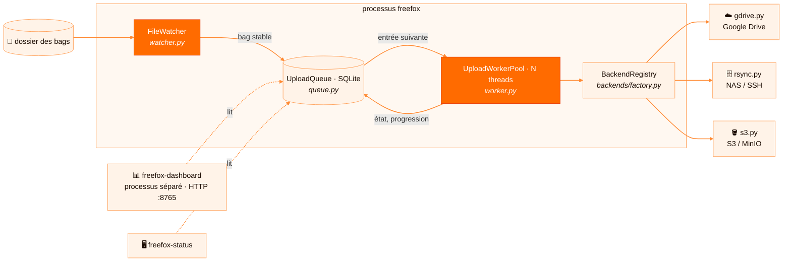
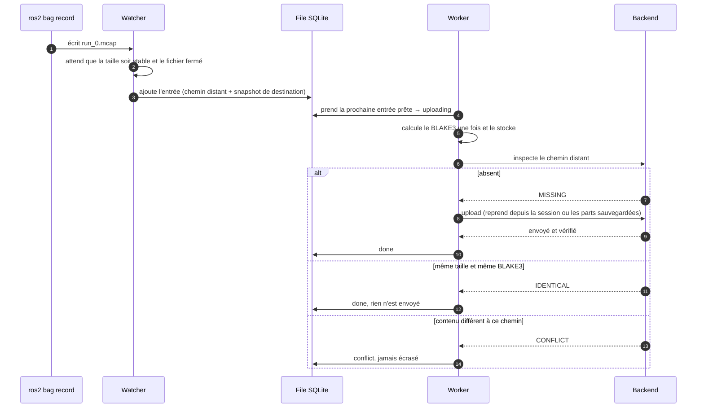
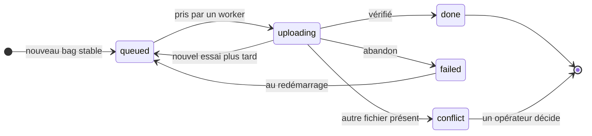
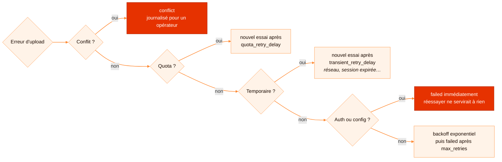

[English](../en/architecture.md) · **Français**

# Architecture

Cette page explique comment FreeFox est construit. Lisez-la avant de modifier la file, un worker ou
un backend.

## Vue d'ensemble



`freefox/service.py` assemble le tout. C'est aussi le point d'entrée de la CLI `freefox`.

## Composants

| Module | Responsabilité |
|---|---|
| `config.py` | Charge le YAML dans des dataclasses typées, applique les surcharges `FREEFOX_*` et valide les réglages des backends. Refuse les secrets S3 dans le YAML. |
| `watcher.py` | Surveille `watch.directory` récursivement (watchdog/inotify, avec un repli en polling). Filtre par extension et par motifs à ignorer, et ne signale un fichier que lorsque sa taille est stable depuis `stable_seconds` et qu'aucun processus ne le tient ouvert (`/proc/*/fd`). |
| `queue.py` | File SQLite durable (WAL). Stocke l'état des transferts, la planification des retries, les URI de session Drive et l'état multipart S3. Migre les anciennes bases sur place. |
| `worker.py` | Pool de threads. Calcule BLAKE3, demande au backend de dédupliquer ou d'uploader, enregistre la progression et traduit les erreurs en décision pour la file. |
| `integrity.py` | BLAKE3 en streaming. |
| `backends/__init__.py` | Contrat indépendant du fournisseur : protocole `StorageBackend`, enum `Inspection` et hiérarchie d'erreurs. |
| `backends/factory.py` | `BackendRegistry` : construit à la demande et met en cache un backend par snapshot de destination. |
| `dashboard.py` | Commande `freefox-dashboard`. Serveur HTTP autonome, bibliothèque standard uniquement. Lit la même base SQLite et sert `/` et `/api/status`. |
| `status.py` | Commande `freefox-status` : affiche la file sous forme de tableau dans le terminal. |

## Cycle de vie d'un bag



1. `ros2 bag record` écrit `run_0.mcap` dans le dossier surveillé.
2. Le watcher le détecte et attend qu'il soit stable et fermé, puis appelle `CollectorService._on_new_bag`.
3. Le service construit le chemin distant `<préfixe>/<robot_id>/<AAAA-MM-JJ>/<fichier>` et ajoute une
   ligne dans la file avec **le nom du backend et un snapshot de sa destination**. Un transfert en
   attente garde donc sa destination d'origine, même si la config change ensuite.
4. Un worker prend la prochaine ligne prête (`queued` et `next_retry_at <= maintenant`) et calcule
   le BLAKE3 une seule fois, en le stockant dans la ligne.
5. Le backend inspecte le côté distant :
   - `MISSING` : upload, avec reprise quand le backend le permet ;
   - `IDENTICAL` (même taille et même BLAKE3) : passage en `done` sans upload ;
   - `CONFLICT` (même chemin, contenu différent) : passage en `conflict`. FreeFox n'écrase jamais.
6. En cas de succès, la ligne passe en `done`. Si `delete_after_upload` est activé, le fichier local
   est supprimé.

## États de la file



- **nouvel essai plus tard** : erreur réseau temporaire, quota, ou backoff exponentiel après une erreur inconnue.
- **abandon** : `max_retries` atteint, ou erreur d'authentification ou de configuration qu'un nouvel essai ne réglerait pas.
- **autre fichier présent** : le chemin distant contient déjà un autre contenu. FreeFox ne l'écrase jamais.
- **au redémarrage** : avec `retry_failed_on_start: true`, les entrées en échec repartent avec de nouveaux essais.

Au démarrage, les lignes laissées en `uploading` par un crash repassent en `queued`.

## Gestion des erreurs

Les backends lèvent des erreurs définies dans `freefox.backends`, et le worker les traduit ainsi :




| Exception | Résultat |
|---|---|
| `ConflictBackendError` | `conflict`, journalisé pour un opérateur |
| `QuotaBackendError` | reporté de `upload.quota_retry_delay` |
| `TransientBackendError` (réseau, credentials expirés, session invalide…) | reporté de `upload.transient_retry_delay` |
| `AuthenticationBackendError`, `ConfigurationBackendError` | `failed` immédiatement (réessayer ne servirait à rien) |
| toute autre erreur | backoff exponentiel `min(base^retries, max)` jusqu'à `max_retries`, puis `failed` |

## Contrat d'un backend

Un backend est un objet qui implémente ce protocole (voir `freefox/backends/__init__.py`) :

```python
class StorageBackend(Protocol):
    def exists(self, remote_path: str) -> bool: ...
    def find_duplicate(self, remote_path: str, blake3_digest: str, size_bytes: int) -> bool: ...
    def upload(self, local_path, remote_path, chunk_size=..., progress_callback=None,
               session_uri="", session_callback=None, blake3_digest="", expected_size=0) -> str: ...
```

Un backend peut aussi définir `upload_entry(entry, queue, local_path, chunk_size, progress_callback)`.
Le worker lui laisse alors le contrôle complet, y compris la déduplication et son propre état de
reprise persisté. Le backend S3 s'en sert pour le multipart.

### Ajouter un backend

1. Créer `freefox/backends/<nom>.py` avec une classe qui implémente le protocole. Importer les SDK
   optionnels à l'intérieur du backend, pour que les utilisateurs qui ne le sélectionnent pas n'en
   aient pas besoin.
2. Ajouter une dataclass `<Nom>Config` et sa lecture YAML dans `config.py`, et ajouter le nom aux
   valeurs acceptées par `storage.backend`.
3. L'enregistrer dans `BackendRegistry.get` et `_snapshot` (`backends/factory.py`).
4. Gérer le préfixe distant et le sous-dossier de date dans `service._build_remote_path`.
5. Traduire les erreurs du fournisseur vers la hiérarchie `freefox.backends`, sans jamais laisser
   fuiter de secrets dans les messages.
6. Stocker le BLAKE3 et la taille côté distant, pour que `inspect` puisse répondre `IDENTICAL` ou
   `CONFLICT`.
7. Ajouter un extra de dépendances dans `pyproject.toml`, des tests avec un faux client (voir
   `tests/conftest.py`), un guide dans `docs/en/` et `docs/fr/`, et une section dans
   `config/config.example.yaml`.

## Principes de conception

- **Ne jamais perdre un bag.** Tout l'état est sur disque, et chaque transition est une transaction SQLite.
- **Ne jamais écraser de données.** Un fichier distant différent est un conflit, jamais un remplacement silencieux.
- **Retries idempotents.** Rejouer n'importe quelle étape doit être sans danger.
- **Peu de dépendances.** Le cœur n'a besoin que de PyYAML, watchdog, blake3 et du client Google. Les autres SDK sont des extras.
- **Adapté au petit matériel.** FreeFox doit tourner sur un Jetson ou un Raspberry Pi, à côté d'une stack ROS 2.
