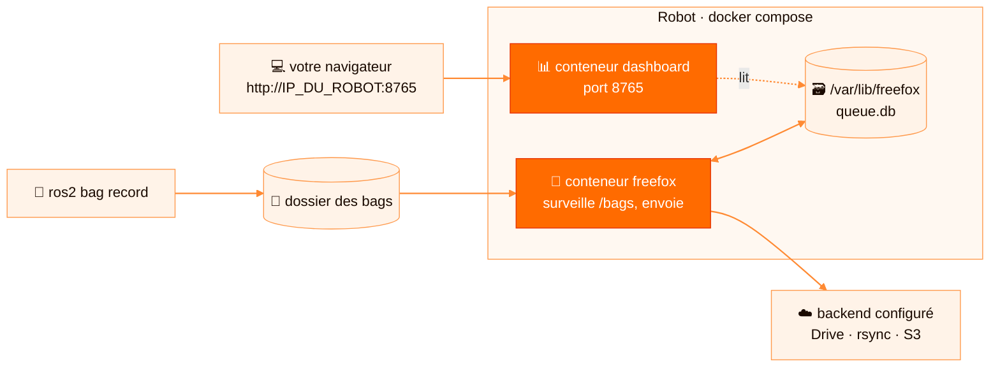
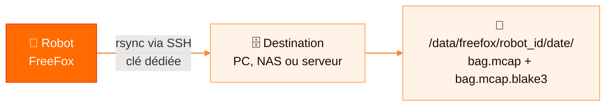

[English](../en/docker-deployment.md) · **Français**

# Déploiement Docker

Docker est une option de déploiement en plus de systemd : il ne le remplace pas, et les deux
peuvent coexister sur la même machine.



Les deux conteneurs partagent la même base SQLite montée depuis l'hôte (`/var/lib/freefox/queue.db`).

## Ce que Docker change

Le code FreeFox ne change pas : seuls les chemins vus par l'application changent.

| Hôte robot | Conteneur |
|---|---|
| `FREEFOX_BAGS_DIR` (ex. `/home/ros/bags`) | `/bags` |
| `FREEFOX_STATE_DIR` (ex. `/var/lib/freefox`) | `/var/lib/freefox` |
| `FREEFOX_CONFIG` (ex. `./config/config.docker.yaml`) | `/etc/freefox/config.yaml` |
| `FREEFOX_SECRETS_DIR` (ex. `./secrets`) | `/etc/freefox/secrets` (lecture seule) |

Dans la config Docker, `watch.directory` doit donc valoir `/bags`, et les chemins de secrets
commencent par `/etc/freefox/secrets/`.

## Checklist nouvelle machine

- Docker et Docker Compose installés
- un dossier de bags local
- un dossier d'état persistant
- les fichiers locaux suivants, **jamais commités** :

```text
docker-compose.yml
.env
config/config.docker.yaml
secrets/…        # credentials du backend choisi
```

Si l'image est déjà publiée sur GHCR, il n'est pas nécessaire de cloner tout le code sur le robot :
ces fichiers suffisent.

## Préparation

```bash
mkdir -p secrets
sudo mkdir -p /var/lib/freefox
sudo chown -R "$(id -u):$(id -g)" /var/lib/freefox

cp .env.example .env
cp config/config.docker.example.yaml config/config.docker.yaml
```

Exemple de `.env` :

```text
FREEFOX_IMAGE=ghcr.io/thoukam/freefox:latest
FREEFOX_UID=1000
FREEFOX_GID=1000
FREEFOX_BAGS_DIR=/home/ros/bags
FREEFOX_STATE_DIR=/var/lib/freefox
FREEFOX_CONFIG=./config/config.docker.yaml
FREEFOX_SECRETS_DIR=./secrets
FREEFOX_DASHBOARD_PORT=8765
```

Exemple minimal de `config/config.docker.yaml` :

```yaml
robot_id: robot-indoor-001

watch:
  directory: /bags

upload:
  quota_retry_delay: 60.0
  transient_retry_delay: 60.0
  retry_failed_on_start: true
  verify_blake3: true
  deduplicate_by_hash: true

queue_db: /var/lib/freefox/queue.db
```

Puis choisissez un backend ci-dessous.

## Backend Google Drive

```yaml
storage:
  backend: gdrive

drive:
  credentials_file: /etc/freefox/secrets/freefox-oauth-client.json
  target_folder_id: "ID_DU_DOSSIER_GOOGLE_DRIVE"
```

```bash
cp /chemin/vers/freefox-oauth-client.json secrets/freefox-oauth-client.json
```

### OAuth2 et token

Un robot sans écran ne peut pas ouvrir de navigateur : préparez le token sur une autre machine.

```bash
FREEFOX_TOKEN_PATH=./secrets/freefox-token.json \
.venv/bin/python scripts/gdrive_smoke.py --config config/local.gdrive.yaml
```

Copiez ensuite `secrets/freefox-token.json` dans `./secrets/` sur le robot. Le
`docker-compose.yml` définit déjà `FREEFOX_TOKEN_PATH: /etc/freefox/secrets/freefox-token.json`.

Voir aussi [google-drive-setup.md](google-drive-setup.md).

## Rsync sur un vrai robot

Pour envoyer les bags vers un PC de supervision, un NAS ou un serveur SSH :



`rsync` et `openssh-client` sont déjà installés dans l'image. Hors Docker :
`sudo apt install -y rsync openssh-client`.

### Sur la machine de destination

```bash
sudo mkdir -p /data/freefox
sudo chown -R "$USER:$USER" /data/freefox
```

Les fichiers arriveront sous :

```text
/data/freefox/<robot_id>/<AAAA-MM-JJ>/<bag.mcap>
/data/freefox/<robot_id>/<AAAA-MM-JJ>/<bag.mcap.blake3>
```

### Sur le robot

Créer une clé SSH dédiée et l'autoriser sur la destination :

```bash
ssh-keygen -t ed25519 -f ./secrets/freefox_rsync -C "freefox-rsync"
ssh-copy-id -i ./secrets/freefox_rsync.pub user@IP_DE_DESTINATION
ssh -i ./secrets/freefox_rsync user@IP_DE_DESTINATION      # test
```

Tester rsync seul avant de lancer FreeFox :

```bash
echo test > /tmp/freefox-rsync-test.txt
rsync -av --mkpath -e "ssh -i ./secrets/freefox_rsync" \
  /tmp/freefox-rsync-test.txt user@IP_DE_DESTINATION:/data/freefox/test/
```

### Configuration

```yaml
storage:
  backend: rsync

rsync:
  destination: user@IP_DE_DESTINATION:/data/freefox
  ssh_command: "ssh -i /etc/freefox/secrets/freefox_rsync -o StrictHostKeyChecking=accept-new"
  options:
    - --archive
    - --partial
    - --inplace
    - --mkpath
    - --info=progress2
  use_date_subfolder: true

upload:
  verify_blake3: true
  deduplicate_by_hash: true
```

La clé locale `./secrets/freefox_rsync` est visible dans le conteneur sous
`/etc/freefox/secrets/freefox_rsync`. Avec BLAKE3 activé, FreeFox envoie un sidecar
`<fichier>.blake3` à côté de chaque bag, ce qui permet de détecter les doublons sans relire le bag
distant.

### Vérification

```bash
docker compose up -d
docker compose logs -f freefox
ssh user@IP_DE_DESTINATION "find /data/freefox -type f | sort | tail -20"
docker compose exec freefox freefox-status /var/lib/freefox/queue.db --limit 10
```

Pour un transfert valide, la colonne `STATUT` affiche `done` et la colonne `INTEGRITE` affiche `OK`.

## Backend S3 / MinIO

L'image inclut l'extra S3, pour `linux/amd64` comme pour `linux/arm64`. Montez les fichiers AWS ou
le CA privé dans `/etc/freefox/secrets` (lecture seule), ou injectez les variables `AWS_*` via votre
gestionnaire de secrets. Ne mettez jamais de clés dans le YAML.

```yaml
storage:
  backend: s3
s3:
  bucket: robot-bags
  endpoint_url: https://minio.example.net
  addressing_style: path
  ca_bundle: /etc/freefox/secrets/minio-ca.pem
```

Détails : [s3-storage.md](s3-storage.md).

## Lancer, arrêter, redémarrer

```bash
docker compose pull          # télécharge l'image GHCR
docker compose up -d
docker compose logs -f freefox
```

Dashboard : `http://IP_DU_ROBOT:8765` (`hostname -I` donne l'IP).

Pour développer depuis le code source, utilisez l'override de build, que Docker Compose fusionne
avec le fichier principal :

```bash
docker compose -f docker-compose.yml -f docker-compose.build.yml up -d --build
```

Arrêter :

```bash
docker compose down
```

La base SQLite et les tokens restent dans `/var/lib/freefox` et `./secrets`. Grâce à
`restart: unless-stopped`, les conteneurs redémarrent après un reboot ou un crash, sauf si vous les
arrêtez explicitement.

## Tester sans casser systemd

```bash
sudo systemctl stop freefox
docker compose up
# si le test ne convient pas :
docker compose down
sudo systemctl start freefox
```

## Points d'attention

- Le dashboard n'a pas encore d'authentification : ne l'exposez pas sur Internet.
- Le conteneur doit pouvoir lire le dossier de bags et écrire dans `/var/lib/freefox`
  (`FREEFOX_UID` / `FREEFOX_GID`).
- Avec OAuth2, protégez `freefox-token.json`.
- Chaque dashboard ne voit que son robot. Superviser une flotte (y compris avec des IP en conflit sur
  des réseaux isolés) demandera un serveur central : c'est sur la feuille de route.

## Commandes utiles

| Commande | Rôle |
|---|---|
| `docker compose ps` | État des conteneurs |
| `docker compose logs -f freefox` | Logs du service |
| `docker compose logs -f dashboard` | Logs du dashboard |
| `docker compose exec freefox sh` | Shell dans le conteneur |
| `docker compose exec freefox freefox-status /var/lib/freefox/queue.db` | État de la file |

## Publication GHCR

Le workflow `.github/workflows/docker-publish.yml` publie `ghcr.io/thoukam/freefox` pour
`linux/amd64` et `linux/arm64`.

Il se déclenche sur un push sur `main`, sur un tag `v*` ou manuellement depuis GitHub Actions, et
produit les tags Docker suivants :

- `latest` sur la branche principale,
- le nom de branche (`main`),
- le SHA court (`sha-abc1234`),
- la version semver pour un tag Git (`0.2.0`, `0.2`),
- un tag manuel optionnel (`workflow_dispatch`).

Publier une version :

```bash
git tag v0.2.0
git push origin v0.2.0
```

Sur le robot, épinglez la version dans `.env` : `FREEFOX_IMAGE=ghcr.io/thoukam/freefox:0.2.0`.

Si le package GHCR est privé, le robot doit faire `docker login ghcr.io` avant `docker compose pull`.
Pour le rendre public : `GitHub -> Packages -> freefox -> Package settings -> Change visibility`.
